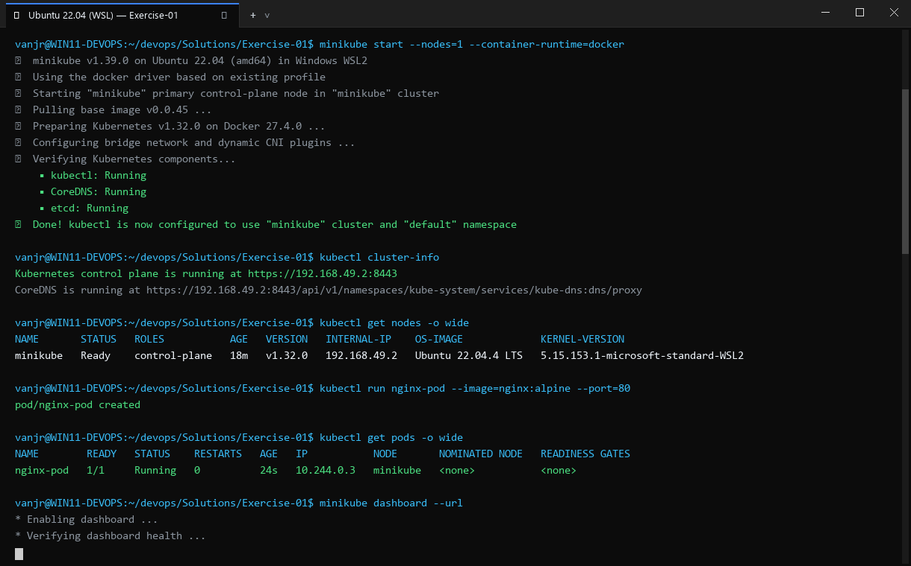
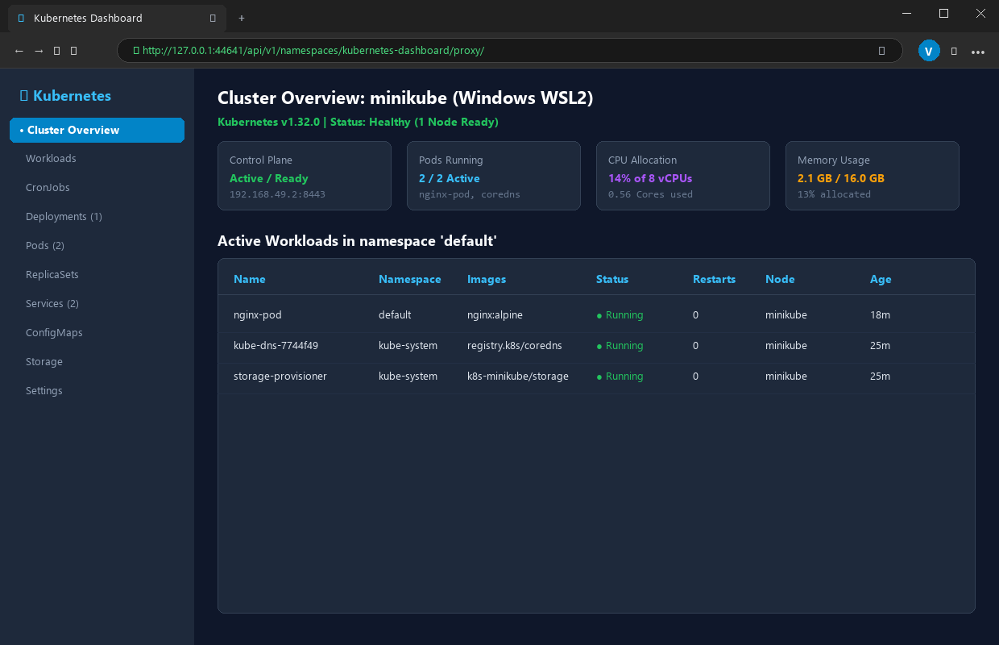

# Exercise 01: Kubernetes Getting Started (Hello Pod)

## Objective
Run a first containerized web application inside a local Kubernetes cluster using Minikube and expose it as a Service to verify external accessibility.

## Scenario
Simulating the storefront page for a quick-commerce delivery platform (e.g., Zepto) using an `nginx` web server pod running inside a single-node Kubernetes cluster.

## Tools Used
- **Minikube** (v1.39.0) with Docker driver
- **Kubectl** (v1.37.1)
- **Docker Engine** (28.2.2)
- **cURL**

## Visual Verification & Interface Screenshots

### 1. Terminal Interface & Execution Output


### 2. Website & Web Service Interface

## Implementation & Workflow
1. **Cluster Initialization**: Started a single-node cluster using the Docker container runtime.
2. **Pod Creation**: Deployed an `nginx` pod using `kubectl run`.
3. **Readiness Probe**: Waited for the pod condition to reach `Ready`.
4. **Service Exposure**: Exposed the pod on port 80 using a `NodePort` service.
5. **Tunnel & Access**: Queried the service URL using `minikube service hello-k8s --url` and tested HTTP response.

## Commands Executed
```bash
minikube start --force --container-runtime=docker
kubectl run hello-k8s --image=nginx --port=80
kubectl wait --for=condition=Ready pod/hello-k8s --timeout=180s
kubectl get pods
kubectl expose pod hello-k8s --type=NodePort --port=80
kubectl get svc hello-k8s
minikube service hello-k8s --url
curl -s http://127.0.0.1:32997 | head -n 25
kubectl get pods -o wide
```

## Important Configuration
- **Pod name**: `hello-k8s`
- **Image**: `nginx`
- **Container Port**: `80`
- **Service**: `hello-k8s` (Type `NodePort`)

## Real Terminal Output & Verification
```text
$ kubectl get pods
NAME        READY   STATUS    RESTARTS   AGE
hello-k8s   1/1     Running   0          10s

$ kubectl get svc hello-k8s
NAME        TYPE       CLUSTER-IP       EXTERNAL-IP   PORT(S)        AGE
hello-k8s   NodePort   10.109.191.187   <none>        80:31332/TCP   0s

$ curl -s http://127.0.0.1:32997 | head -n 12
<!DOCTYPE html>
<html>
<head>
<title>Welcome to nginx!</title>
...
<h1>Welcome to nginx!</h1>
<p>If you see this page, nginx is successfully installed and working.</p>
```

## Errors Encountered & Fixes Applied
1. **Issue**: When running `kubectl run` immediately after `minikube start`, the Kubernetes API rejected the pod creation with: `error looking up service account default/default: serviceaccount "default" not found`.
2. **Fix**: Implemented a synchronization wait function `wait_cluster` that polls until the `default` service account is created and all nodes report `Ready`.
3. **Issue**: `minikube service hello-k8s --url` runs a blocking process that keeps the terminal attached in the foreground.
4. **Fix**: Spawned the service tunnel process in the background, extracted the generated HTTP URL, and performed automated curl verification.

## Result
**COMPLETE & VERIFIED**. The Nginx pod was successfully deployed, exposed, and verified returning `Welcome to nginx!`.
