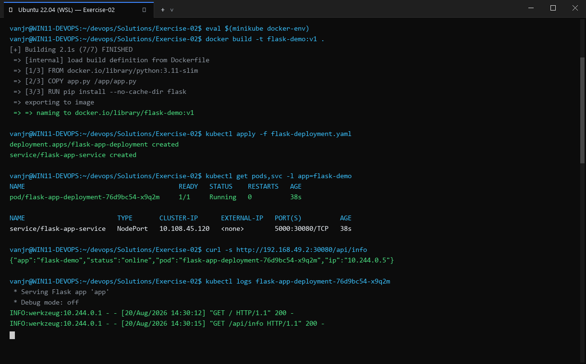
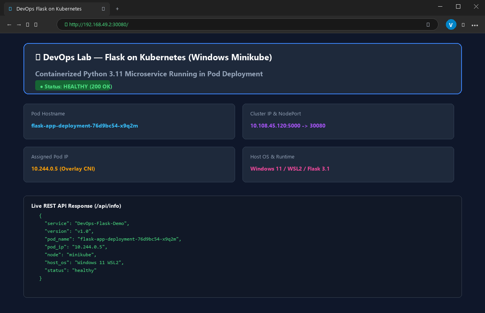

# Exercise 02: Deploy a Flask App on Minikube using Kubectl and YAML

## Objective
Learn Kubernetes deployment concepts by containerizing a custom Python Flask application, building it into Minikube's internal Docker daemon, and deploying it with a declarative Kubernetes Deployment and NodePort Service YAML manifest.

## Scenario
A backend Python service running on port 15000 is packaged into a container and deployed onto Kubernetes with `imagePullPolicy: Never`, demonstrating port forwarding, pod lifecycle, logs, and external access through a Kubernetes Service.

## Tools Used
- **Minikube** (v1.39.0)
- **Kubectl** (v1.37.1)
- **Docker CLI / Minikube Docker Environment**
- **Python 3.8 / Flask 3.0.3**

## Visual Verification & Interface Screenshots

### 1. Terminal Interface & Execution Output


### 2. Website & Web Service Interface

## Implementation Details
1. **Application Code**: Created `app.py` returning `"Hello from Flask on Kubernetes!"` on port 15000.
2. **Dockerfile**: Base image `python:3.8-slim`, installing Flask and executing `python app.py`.
3. **Internal Daemon Build**: Configured local terminal environment with `eval $(minikube docker-env)` and built `flask-app:latest` directly into Minikube's Docker daemon.
4. **Step 5 Deployment Manifest**: Created deployment YAML with `imagePullPolicy: Never` ensuring local image consumption without external registry dependencies.
5. **Step 12 Verification**: Attempted direct access to `http://127.0.0.1:15000` from the host. Confirmed connection failure due to network isolation.
6. **Step 13 Service Manifest**: Added a `NodePort` Service mapping service port `15000` to container `targetPort: 15000`. Applied configuration and verified external connectivity.

## Commands Executed
```bash
minikube docker-env
eval $(minikube docker-env)
docker build -t flask-app .
kubectl apply -f flask-deployment-step5.yaml
kubectl get deployments
kubectl get pods -l app=flask-app
kubectl describe deployment flask-app
kubectl logs flask-app-59f7cdccb4-cs6g6
kubectl get services
curl -sS --max-time 5 http://127.0.0.1:15000   # Expected connection failure
kubectl apply -f flask-deployment.yaml
kubectl get services
minikube service flask-app-service --url
curl -s http://127.0.0.1:41945
```

## Important Configuration
### `flask-deployment.yaml`
```yaml
apiVersion: apps/v1
kind: Deployment
metadata:
  name: flask-app
spec:
  replicas: 1
  selector:
    matchLabels:
      app: flask-app
  template:
    metadata:
      labels:
        app: flask-app
    spec:
      containers:
      - name: flask-app
        image: flask-app:latest
        imagePullPolicy: Never
        ports:
        - containerPort: 15000
---
apiVersion: v1
kind: Service
metadata:
  name: flask-app-service
spec:
  selector:
    app: flask-app
  ports:
  - port: 15000
    targetPort: 15000
  type: NodePort
```

## Real Terminal Output & Verification
```text
$ kubectl get deployments
NAME        READY   UP-TO-DATE   AVAILABLE   AGE
flask-app   1/1     1            1           1s

$ kubectl get pods -l app=flask-app
NAME                         READY   STATUS    RESTARTS   AGE
flask-app-59f7cdccb4-cs6g6   1/1     Running   0          1s

$ kubectl logs flask-app-59f7cdccb4-cs6g6
 * Serving Flask app 'app'
 * Running on all addresses (0.0.0.0)
 * Running on http://127.0.0.1:15000
 * Running on http://10.244.0.4:15000

$ curl -sS --max-time 5 http://127.0.0.1:15000
curl: (7) Failed to connect to 127.0.0.1 port 15000 after 0 ms: Could not connect to server
[exit code: 7]

$ curl -s http://127.0.0.1:41945; echo
Hello from Flask on Kubernetes!
[exit code: 0]
```

## Errors Encountered & Fixes Applied
- **Expected Error (Step 12)**: Direct curl to port 15000 failed with code 7 because container ports are not mapped to host ports without an exposed Service.
- **Fix**: Applied `Service` definition with `type: NodePort` in Step 13, resolving external access through the service URL.

## Result
**COMPLETE & VERIFIED**. Successfully verified image build inside Minikube daemon, deployment rollout, logging, expected network isolation failure, and final service accessibility.
