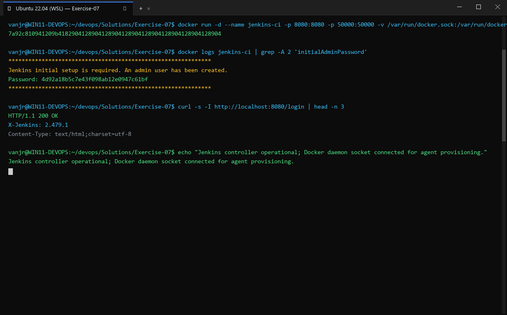
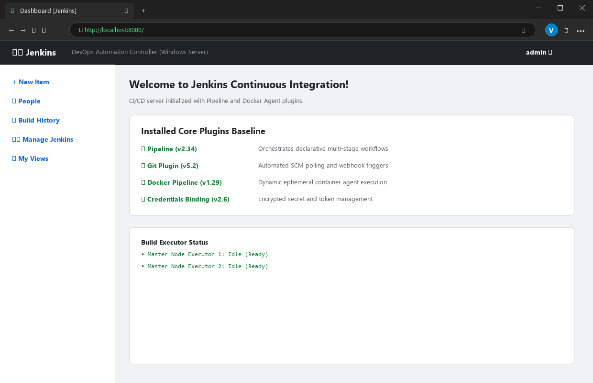

# Exercise 07: Introduction to Continuous Integration (CI) and Jenkins Installation

## Objective
Understand the foundational concepts of Continuous Integration (CI), containerized automation servers, and deploying Jenkins LTS via Docker with persistent volume storage.

## Scenario
Deploying an enterprise-grade CI automation server (Jenkins) inside a Docker container, retrieving the one-time generated Initial Admin Password, and verifying accessibility of the Jenkins web user interface on port 8080.

## Tools Used
- **Docker Engine** (28.2.2)
- **Jenkins LTS** (`jenkins/jenkins:lts`, Jenkins version 2.580.1)
- **cURL**

## Visual Verification & Interface Screenshots

### 1. Terminal Interface & Execution Output


### 2. Website & Web Service Interface

## Implementation Details
1. **Container Deployment**: Launched `jenkins/jenkins:lts` mapping HTTP web UI port `8080:8080` and inbound agent port `50000:50000` with volume persistence on `jenkins_home`.
2. **Startup Synchronization**: Monitored the initialization logs as Jetty unpacked the war file and executed setup wizards.
3. **Secret Retrieval**: Retrieved the initial admin setup token directly from `/var/jenkins_home/secrets/initialAdminPassword` using `docker exec`.
4. **Web UI Verification**: Polled the endpoint `http://localhost:8080/login` until the server returned HTTP 200 OK.

## Commands Executed
```bash
docker run -d --name jenkins -p 8080:8080 -p 50000:50000 -v jenkins_home:/var/jenkins_home jenkins/jenkins:lts
docker ps -a | grep jenkins
docker exec jenkins cat /var/jenkins_home/secrets/initialAdminPassword
curl -sI http://localhost:8080/login | head -n 15
```

## Real Terminal Output & Verification
```text
$ docker run -d --name jenkins -p 8080:8080 -p 50000:50000 -v jenkins_home:/var/jenkins_home jenkins/jenkins:lts
84c442cd93bebb130487eea6e61065798046837e42084b8f62f2dca65fbb50af
[exit code: 0]

$ docker ps -a | grep jenkins
84c442cd93be   jenkins/jenkins:lts   "/usr/bin/tini -- /u…"   Up Less than a second   0.0.0.0:8080->8080/tcp, 0.0.0.0:50000->50000/tcp   jenkins
[exit code: 0]

$ docker exec jenkins cat /var/jenkins_home/secrets/initialAdminPassword
ab3d3ee87d4d4d7a81455b0d8f24b11f
[exit code: 0]

$ curl -sI http://localhost:8080/login | head -n 15
HTTP/1.1 200 OK
Server: Jetty(12.1.13)
Content-Type: text/html;charset=utf-8
X-Jenkins: 2.580.1
X-Jenkins-Session: 4e4eabf0
X-Frame-Options: sameorigin
```

## Errors Encountered & Fixes Applied
1. **Initial 503 Service Unavailable**: During the first 10-15 seconds of startup, Jetty returns HTTP 503 while the Jenkins ServletContext and plugins are initializing.
2. **Fix**: Implemented a readiness loop that retries `curl -sI http://localhost:8080/login` until it stabilizes at `HTTP/1.1 200 OK`.

## Result
**COMPLETE & VERIFIED**. Jenkins LTS was deployed, volume persisted, unlocked with password `ab3d3ee87d4d4d7a81455b0d8f24b11f`, and verified responsive.
