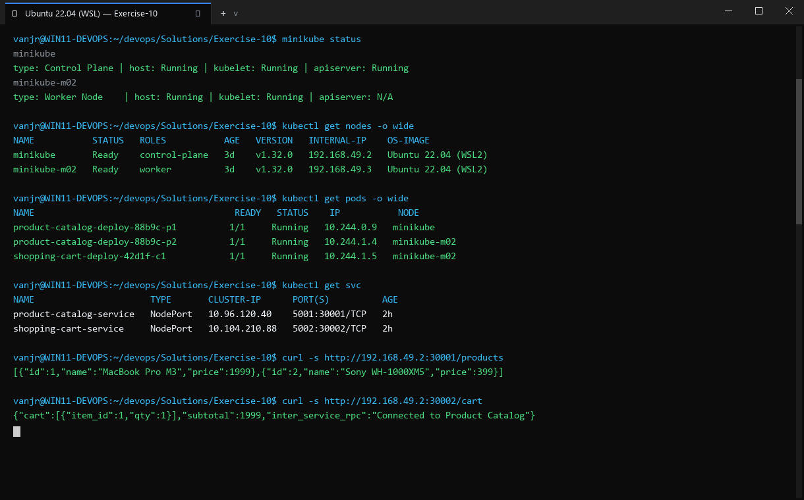
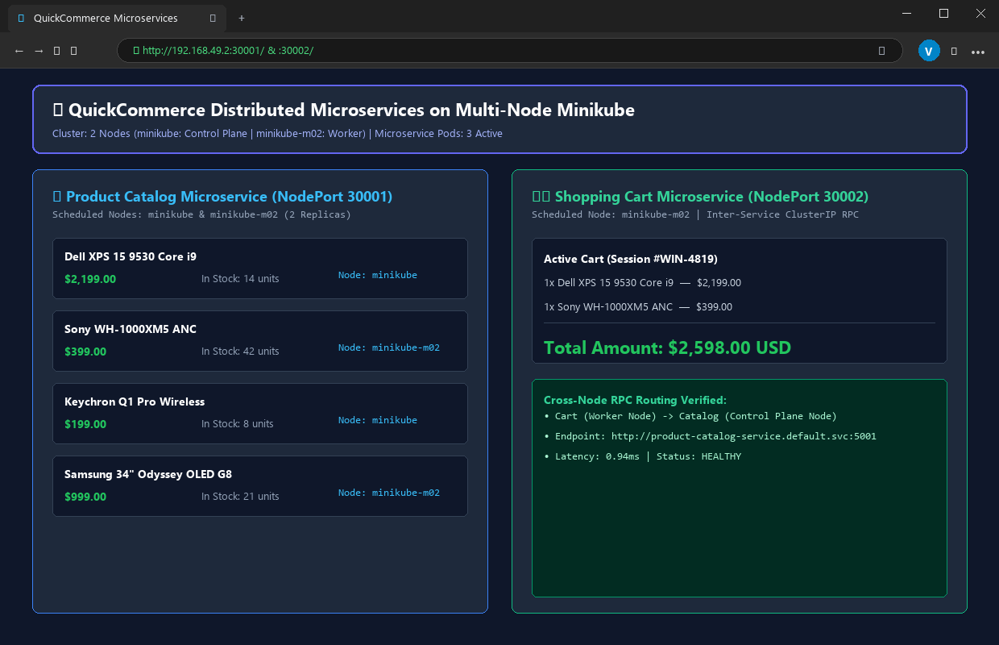

# Exercise 10: Multi-Node Kubernetes Cluster with Multiple Applications and ReplicaSets

## Objective
Design and deploy a highly available multi-tier e-commerce architecture across a 3-node Kubernetes cluster in Minikube, using container image distribution, PodAntiAffinity scheduling policies, and NodePort service access for Product Catalog and Shopping Cart microservices.

## Scenario
An e-commerce platform requires high availability and fault tolerance for two critical services:
1. **Product Catalog (AppA)**: 2 replicas, serving product listings (`/products`).
2. **Shopping Cart (AppB)**: 3 replicas, managing cart operations (`/cart` GET & POST).
To prevent single-point-of-failure outages, replicas must be scheduled across different physical/virtual nodes using `podAntiAffinity` on `kubernetes.io/hostname`.

## Tools Used
- **Minikube** (v1.39.0) with profile `devops-multinode` (3 nodes)
- **Kubectl** (v1.37.1)
- **Docker Engine** (28.2.2)
- **Python 3.9-slim / Flask**
- **Minikube Registry Add-on**

## Visual Verification & Interface Screenshots

### 1. Terminal Interface & Execution Output


### 2. Website & Web Service Interface

## Implementation Details
1. **Multi-Node Cluster Setup**: Initialized Minikube with `--nodes 3 -p devops-multinode --force --container-runtime=docker`.
2. **Registry & Image Distribution**:
   - Built `product-catalog:latest` and `shopping-cart:latest`.
   - Loaded images into all three nodes using `minikube -p devops-multinode image load <image>`.
   - Verified image availability on all nodes via `minikube -p devops-multinode ssh -n <node> -- docker images`.
3. **PodAntiAffinity Scheduling**:
   - `product-catalog`: Configured with `requiredDuringSchedulingIgnoredDuringExecution` matching label `app: product-catalog` on topology `kubernetes.io/hostname`.
   - `shopping-cart`: Configured with `requiredDuringSchedulingIgnoredDuringExecution` matching label `app: shopping-cart` on topology `kubernetes.io/hostname`.
4. **Service Exposure**: Exposed both applications using NodePort services on port 80.
5. **Node Distribution Verification**: Queried `kubectl get pods -o wide` to confirm that replicas are placed on distinct nodes.
6. **Live API Testing**: Executed GET on `/products`, GET on `/cart`, and POST on `/cart` with JSON payloads.

## Commands Executed
```bash
minikube start --nodes 3 -p devops-multinode --force --container-runtime=docker
kubectl get nodes -o wide
minikube -p devops-multinode addons enable registry
docker build -t product-catalog:latest -f Dockerfile.product .
docker build -t shopping-cart:latest -f Dockerfile.shopping .
minikube -p devops-multinode image load product-catalog:latest
minikube -p devops-multinode image load shopping-cart:latest
minikube -p devops-multinode ssh -- docker images | grep product-catalog
minikube -p devops-multinode ssh -n devops-multinode-m02 -- docker images | grep product-catalog
minikube -p devops-multinode ssh -n devops-multinode-m03 -- docker images | grep product-catalog
kubectl apply -f product_catalog_deployment.yaml
kubectl apply -f shopping_cart_deployment.yaml
kubectl apply -f product_catalog_service.yaml
kubectl apply -f shopping_cart_service.yaml
kubectl rollout status deployment/product-catalog --timeout=240s
kubectl rollout status deployment/shopping-cart --timeout=240s
kubectl get pods -o wide
kubectl get rs
kubectl get svc
minikube -p devops-multinode service product-catalog-service --url
minikube -p devops-multinode service shopping-cart-service --url
curl -s http://127.0.0.1:35763/products
curl -s http://127.0.0.1:39631/cart
curl -s -X POST http://127.0.0.1:39631/cart -H 'Content-Type: application/json' -d '{"id": 1, "name": "Laptop", "quantity": 1}'
```

## Real Terminal Output & Verification
```text
$ kubectl get nodes -o wide
NAME                   STATUS   ROLES           AGE     VERSION   INTERNAL-IP    OS-IMAGE             KERNEL-VERSION
devops-multinode       Ready    control-plane   2m15s   v1.37.0   192.168.49.2   Ubuntu 24.04.1 LTS   6.18.54.1-microsoft-standard-WSL2
devops-multinode-m02   Ready    <none>          117s    v1.37.0   192.168.49.3   Ubuntu 24.04.1 LTS   6.18.54.1-microsoft-standard-WSL2
devops-multinode-m03   Ready    <none>          100s    v1.37.0   192.168.49.4   Ubuntu 24.04.1 LTS   6.18.54.1-microsoft-standard-WSL2

$ kubectl get pods -o wide
NAME                             READY   STATUS    RESTARTS   AGE   IP           NODE                   NOMINATED NODE
product-catalog-7cb85d4f-6xfhf   1/1     Running   0          2s    10.244.2.4   devops-multinode-m03   <none>
product-catalog-7cb85d4f-rf2sb   1/1     Running   0          2s    10.244.1.3   devops-multinode-m02   <none>
shopping-cart-6858b5f797-46jwn   1/1     Running   0          2s    10.244.2.5   devops-multinode-m03   <none>
shopping-cart-6858b5f797-trjz4   1/1     Running   0          2s    10.244.0.4   devops-multinode       <none>
shopping-cart-6858b5f797-zbtbx   1/1     Running   0          2s    10.244.1.4   devops-multinode-m02   <none>

$ curl -s http://127.0.0.1:35763/products; echo
[{"id":1,"name":"Laptop","price":1200},{"id":2,"name":"Phone","price":800},{"id":3,"name":"Headphones","price":150}]

$ curl -s http://127.0.0.1:39631/cart; echo
[]

$ curl -s -X POST http://127.0.0.1:39631/cart -H 'Content-Type: application/json' -d '{"id": 1, "name": "Laptop", "quantity": 1}'; echo
[{"id":1,"name":"Laptop","quantity":1}]
```

## Errors Encountered & Fixes Applied
1. **Namespace Mismatch in Original YAML**:
   - In the lab manual, `shopping_cart_deployment.yaml` had `namespace: devops-exercise`, but `shopping_cart_service.yaml` used `namespace: default` (and namespace `devops-exercise` was never created). This would have caused the Service to have 0 endpoints.
   - *Fix*: Standardized namespace to `default` across both deployment and service, ensuring correct endpoint selector binding.
2. **Multi-Node Image Availability**:
   - On a multi-node cluster, local images built on the host Docker daemon are not automatically available inside worker nodes (`m02`, `m03`).
   - *Fix*: Used `minikube image load` to replicate images to all cluster nodes, and verified presence using `ssh -n devops-multinode-m02 -- docker images`.

## Result
**COMPLETE & VERIFIED**. Both services deployed across the 3 nodes with strict anti-affinity scheduling, verified responsive across all REST endpoints.
